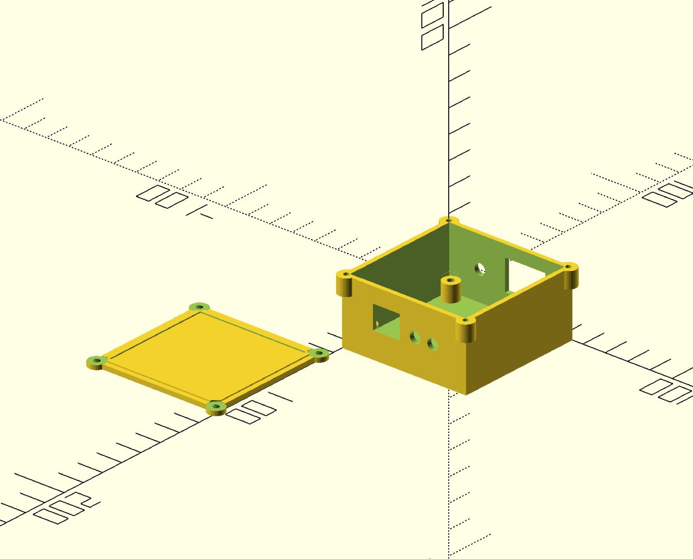
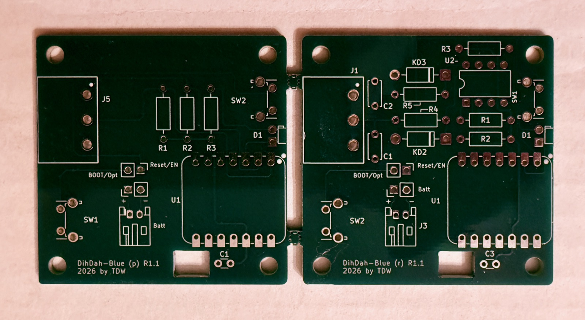
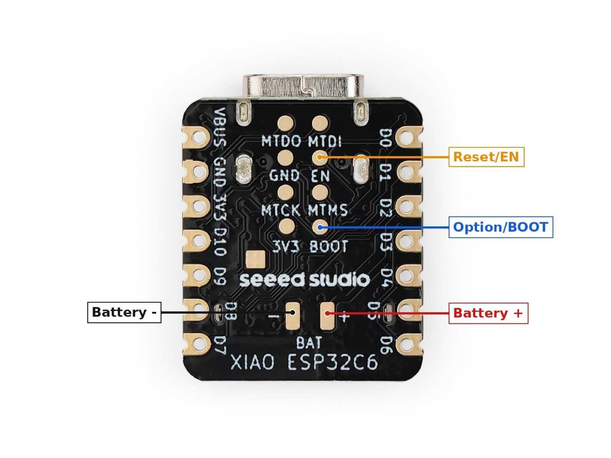
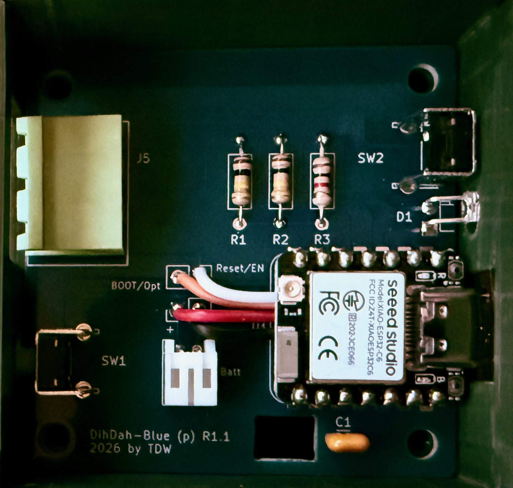

# Dih Dah Blue

**A Bluetooth LE wireless link between a Morse code (CW) paddle and a radio.**

Dih Dah Blue replaces the cable between your CW paddle and your radio with a pair of small battery-powered boards. The paddle-side board watches the paddle contacts and sends each transition over Bluetooth LE. The radio-side board drives a solid-state relay wired to the radio's key input. To your radio, it looks like the paddle is plugged straight in.

This repository holds the firmware, KiCad schematics and PCB layouts, and the 3D-printable enclosure described in the *Circuit Cellar* article **"Dih Dah Blue – Bluetooth Remote CW Key"** by Todd Wade, W8LEV.



## How it works

Both boards are built around the Seeed Studio XIAO ESP32-C6. The module provides a RISC-V high-power (HP) core and an ultra-low-power (ULP/LP) core, a built-in LiPo charger and a USB-C port for power and programming.

| | Paddle side | Radio side |
|---|---|---|
| BLE role | Central | Peripheral (advertises as `CW_Radio`) |
| Connects to | Paddle via 3-position terminal block (left, right, common) | Radio key input via 3-position terminal block, through an ASSR-1228 2-pole solid-state relay |
| Power strategy | ULP core watches the paddle while the HP core sleeps. HP core goes to light sleep after 2 min idle and deep sleep after 10 min | HP core only, light sleep when idle |
| Typical idle current | ~90 µA | ~17 mA |

**Paddle side:** The ULP core debounces the paddle inputs, places time-stamped events on a queue shared with the HP core, then wakes the HP core. The HP core re-establishes the BLE link if needed and sends each queued event to the radio side. While the link is idle, the HP core steps down from light sleep to deep sleep. A paddle tap wakes everything back up, and the LED blinks three times quickly once the link is up.

**Radio side:** Accepts the connection, receives paddle events and drives the relay outputs to match.

## Repository layout

```
firmware/
  paddle/     ESP-IDF project: HP core (main/main.c) + ULP core (main/ulp/)
  radio/      ESP-IDF project: radio-side BLE peripheral
hardware/
  paddle/     KiCad project, schematic PDF and BOM for the paddle-side board
  radio/      KiCad project, schematic PDF and BOM for the radio-side board
  panel/      Both boards panelized into one 2-up panel, with ready-to-order Gerbers
enclosure/    OpenSCAD source and STL for the shared enclosure
docs/images/  Photos and renders
```

## Building the hardware

Each board is 2" × 2" and uses only through-hole parts. You can also build the circuits on a breadboard or stripboard.

- **Schematics:** [`hardware/paddle/Paddle-schematic.pdf`](hardware/paddle/Paddle-schematic.pdf) and [`hardware/radio/radio-schematic.pdf`](hardware/radio/radio-schematic.pdf)
- **Bills of materials:** [`hardware/paddle/Paddle-BOM.csv`](hardware/paddle/Paddle-BOM.csv) and [`hardware/radio/radio-BOM.csv`](hardware/radio/radio-BOM.csv)
- **Ordering PCBs:** Upload [`hardware/panel/dihdah_blue_r2-gerbers.zip`](hardware/panel/dihdah_blue_r2-gerbers.zip) to JLCPCB, PCBWay or a similar board house. It holds both boards on a single panel joined by mouse-bite tabs. Snap them apart and sand the edges.



**Assembly notes:**

1. Solder the low-profile parts first (resistors and capacitors), then the battery connector, then the buttons.
2. If you'll use the enclosure, bend the LED leads 90° about 1/8" above the board so the LED pokes through the enclosure hole. The cathode goes to the square pad nearest the board edge.
3. **Install the XIAO module last.** Its battery and RESET/EN and BOOT connections are only on pads underneath the module. *Before* soldering the module down, solder four wires to the **Battery +**, **Battery −**, **Reset/EN** and **Option/BOOT** pads on its underside. Route the wires out from under the edge opposite the USB-C connector. Then solder the module's header pins, trim the wires and solder them to the four labeled holes near the battery connector.





> **Article correction:** The article text says R2 and R3 are the paddle input pull-ups and R1 is the LED resistor. On both boards **R3 (1K) is the LED resistor**. On the paddle side, **R1 and R2 (100K) are the paddle input pull-ups**. The schematics (Figures 1 and 2), the PCBs and the files here are correct.

**Battery:** Either board runs from a single-cell 3.7 V LiPo (the author uses Adafruit's 500 mAh flat pack) or directly from USB-C. Buy batteries from a reputable supplier. A slot in the PCB lets the battery lead pass up from below the board.

> **Radio-side note:** The relay output is meant for "dry contact" key inputs on radios or keyers with a built-in electronic keyer. Don't connect it to older rigs that put a voltage on the key line.

## Building the firmware

Requires [ESP-IDF](https://docs.espressif.com/projects/esp-idf/en/v5.3.4/esp32c6/get-started/) **v5.3.x** (developed on v5.3.4).

```sh
cd firmware/radio        # or firmware/paddle
idf.py set-target esp32c6
idf.py build
idf.py -p <serial-port> flash monitor
```

The paddle project builds the ULP program in `main/ulp/` and embeds it into the HP-core image automatically.

To force a XIAO into the bootloader, hold **BOOT** (SW2) while pressing **RESET/EN** (SW1).

### Current limitations / ideas for future versions

- The paddle mode is fixed at NORMAL. REVERSED, IAMBIC_A and IAMBIC_B are defined but not yet selectable.
- Each event carries a timestamp, but the radio side doesn't yet use it to reconstruct paddle timing.
- Settings could be made configurable through the BOOT button, a serial console or a phone app.

## Enclosure

[`enclosure/dihdah_blue_enclosure.scad`](enclosure/dihdah_blue_enclosure.scad) is a parametric OpenSCAD design (Listing 1 in the article). It fits either board, and [`dihdah_blue_enclosure.stl`](enclosure/dihdah_blue_enclosure.stl) is ready to slice. GitHub shows the STL in a 3D viewer.

- PCB mounting: M3 × 8 mm pan-head self-tapping screws
- Lid: M2.5 × 8 mm countersunk self-tapping screws
- The design isn't meant for repeated opening. Switch to brass heat-set inserts and machine screws if you'll open it often.

## License

- **Firmware** (`firmware/`): [MIT](LICENSE)
- **Hardware and enclosure** (`hardware/`, `enclosure/`): [CERN-OHL-P-2.0](hardware/LICENSE)

© 2024–2026 Todd D. Wade, W8LEV
